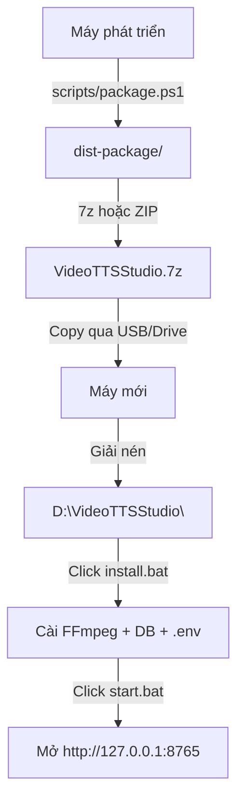

# Hướng dẫn đóng gói và phân phối Video TTS Studio

> Tài liệu này hướng dẫn cách đóng gói ứng dụng thành bản phân phối
> **không cần cài đặt bất kỳ phần mềm nào** trên máy đích.

---

## Tổng quan

Bản phân phối chứa tất cả trong một thư mục duy nhất:

```text
dist-package/
├── .python/              ← Python embedded 3.12 + tất cả packages
├── .tools/
│   ├── ffmpeg/           ← FFmpeg + FFprobe
│   ├── huggingface/      ← Model VieNeu-TTS (~2 GB, ONNX)
│   └── postgresql/       ← PostgreSQL portable
├── backend/              ← Mã nguồn backend
├── frontend/
│   └── dist/             ← Frontend đã build sẵn
├── scripts/
│   └── first-setup.ps1   ← Script cài đặt tự động
├── skills/               ← Skill templates
├── docs/                 ← Tài liệu
├── install.bat           ← ★ Click đúp để cài đặt lần đầu
└── start.bat             ← ★ Click đúp để chạy ứng dụng
```

Máy đích **chỉ cần Windows 10/11 (64-bit)**, không cần cài thêm gì.

---

## A. Đóng gói (trên máy phát triển)

### Bước 1: Chạy script đóng gói

```powershell
cd D:\D\tools\video-tts-studio

# Đóng gói CPU-only (~5 GB, khuyên dùng)
powershell -ExecutionPolicy Bypass -File .\scripts\package.ps1

# Hoặc đóng gói có cả GPU/CUDA (~10 GB)
powershell -ExecutionPolicy Bypass -File .\scripts\package.ps1 -IncludeGPU
```

Script sẽ:
1. Copy mã nguồn (không bao gồm data, test, cache thừa)
2. Build frontend nếu chưa có
3. Tải Python embedded 3.12
4. Cài tất cả Python packages vào thư mục embedded
5. Copy model HuggingFace (~2 GB)
6. Copy FFmpeg và PostgreSQL portable
7. Tạo `install.bat` và `start.bat`

### Bước 2: Nén thành file phân phối

```powershell
# Dùng 7-Zip (nén tốt hơn ZIP ~30-40%)
& "C:\Program Files\7-Zip\7z.exe" a -t7z -mx=5 "VideoTTSStudio-v1.0-CPU.7z" ".\dist-package\*"

# Hoặc dùng ZIP tiêu chuẩn
Compress-Archive -Path ".\dist-package\*" -DestinationPath "VideoTTSStudio-v1.0-CPU.zip"
```

> [!TIP]
> - Dùng 7z với `-mx=5` (nén vừa) để cân bằng tốc độ và dung lượng.
> - File 7z sẽ khoảng **2-3 GB** cho bản CPU-only.
> - File ZIP sẽ khoảng **3-4 GB**.

### Bước 3: Chia sẻ

Gửi file nén qua:
- USB / ổ cứng ngoài
- Google Drive / OneDrive
- Mạng nội bộ (LAN share)

---

## B. Cài đặt (trên máy mới)

### Bước 1: Giải nén

Giải nén file vào bất kỳ thư mục nào, ví dụ:
```
D:\VideoTTSStudio\
```

> [!IMPORTANT]
> - **Không** giải nén vào thư mục có dấu cách trong tên (vd: `C:\Program Files\`)
> - **Không** giải nén vào thư mục cần quyền admin (vd: `C:\Windows\`)
> - Khuyên dùng: `D:\VideoTTSStudio\` hoặc `C:\Tools\VideoTTSStudio\`

### Bước 2: Chạy cài đặt lần đầu

**Click đúp `install.bat`**

Script tự động:
1. ✅ Kiểm tra Python embedded
2. ✅ Tải FFmpeg nếu thiếu (~200 MB)
3. ✅ Tải PostgreSQL portable nếu thiếu (~300 MB)
4. ✅ Khởi tạo database, tạo user, tạo mật khẩu tự động
5. ✅ Ghi file `.env` tự động
6. ✅ Kiểm tra model TTS

Toàn bộ mất khoảng **3-5 phút** (tùy tốc độ mạng nếu cần tải thêm).

### Bước 3: Chạy ứng dụng

**Click đúp `start.bat`**

Mở trình duyệt tại: **http://127.0.0.1:8765**

Nhấn `Ctrl+C` trong cửa sổ terminal để dừng server.

---

## C. Sơ đồ quy trình



---

## D. Câu hỏi thường gặp

### Máy đích có cần Internet không?

- **Không**, nếu bản đóng gói đã bao gồm FFmpeg, PostgreSQL và model cache.
- **Có** (lần đầu), nếu thiếu FFmpeg hoặc PostgreSQL (script sẽ tự tải).
- **Có** (lần đầu dùng TTS), nếu thiếu model cache (~2 GB).

### Dung lượng bao nhiêu?

| Thành phần | Kích thước |
|---|---|
| Python embedded + packages (CPU) | ~1 GB |
| Model VieNeu-TTS ONNX | ~2 GB |
| FFmpeg | ~200 MB |
| PostgreSQL portable | ~300 MB |
| Source code + frontend | ~1 MB |
| **Tổng (trước nén)** | **~3.5 GB** |
| **Sau nén 7z** | **~2 GB** |

### Có chạy được trên máy có GPU không?

Có. Nếu đóng gói với `-IncludeGPU`, ứng dụng sẽ tự nhận GPU.
Bản CPU-only vẫn chạy trên máy có GPU, chỉ là dùng CPU.

### Muốn cập nhật phiên bản mới?

1. Chạy lại `package.ps1` trên máy phát triển
2. Gửi file nén mới
3. Giải nén đè lên (database trong `data/` sẽ được giữ)

Hoặc chỉ copy các file source code thay đổi (không cần đóng gói lại toàn bộ).

### Port 8765 bị chiếm?

Sửa `APP_PORT` trong `.env` và dùng port khác.

### Quên mật khẩu database?

Mật khẩu tự động được lưu tại `data\credentials\`. File `.env` cũng chứa
mật khẩu trong `DATABASE_URL`.

---

## E. Đóng gói thủ công (không dùng script)

Nếu muốn kiểm soát chi tiết, làm theo thứ tự:

1. **Python embedded**: tải từ python.org, sửa `._pth` để bật `import site`
2. **Cài packages**: `python.exe -m pip install vieneu==3.8.3` + `backend/requirements.txt`
3. **Build frontend**: `npm run build` rồi copy `frontend/dist/`
4. **FFmpeg**: tải bản essentials từ GitHub
5. **PostgreSQL**: tải binary từ EDB
6. **Model cache**: copy `.tools/huggingface/` từ máy đã chạy
7. **Tạo launcher**: viết `.bat` đặt PATH và PYTHONPATH đúng

---

## F. Lưu ý bảo mật

> [!WARNING]
> - File `data\credentials\` chứa mật khẩu database — không chia sẻ.
> - `.env` chứa `DATABASE_URL` có mật khẩu — không commit lên git.
> - Ứng dụng chỉ listen trên `127.0.0.1` — an toàn cho máy local.

